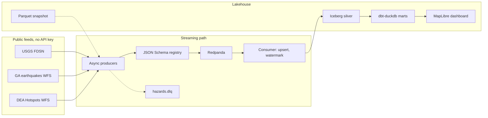
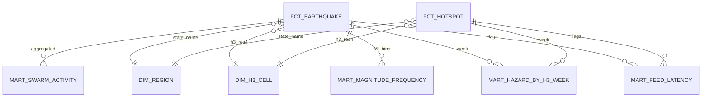

# aus-hazard-stream

Near real-time streaming lakehouse for Australian earthquakes and bushfire hotspots. Public feeds land on Redpanda, survive a versioned contract, and are upserted into an Apache Iceberg warehouse. dbt-duckdb builds the marts. A static map on GitHub Pages is the decision surface.

[](https://github.com/LuciferDataEngineer/aus-hazard-stream/actions/workflows/ci.yml)
[](https://github.com/LuciferDataEngineer/aus-hazard-stream/actions/workflows/pages.yml)
[](https://github.com/LuciferDataEngineer/aus-hazard-stream/actions/workflows/refresh.yml)
[](LICENSE)
[](pyproject.toml)
[](docker-compose.yml)
[](src/aus_hazard/lake.py)
[](dbt/dbt_project.yml)
[](dbt/profiles.yml)
[](src/aus_hazard/definitions.py)

Live dashboard: <https://luciferdataengineer.github.io/aus-hazard-stream/>

This is not a warning service. Official alerts stay with [Geoscience Australia](https://earthquakes.ga.gov.au/), state emergency services, and the Bureau of Meteorology.

## Why this, and why now

South Gippsland has been shaking. The ABC reported on [28 Oct 2026](https://www.abc.net.au/news/2026-10-28/earthquake-arawata-leongatha-tremors-geoscience-australia/107317128) that an M3.5 at Arawata, felt in Melbourne, was the 18th Victorian quake since 26 Sep, after an early-October event felt by about 20,000 people. The day before, an [M4.9 offshore of South Australia](https://www.abc.net.au/news/2026-10-27/earthquake-reported-by-residents-around-adelaide/107312622) was felt around Adelaide. On 29 Oct a suspicious bushfire at Kalamunda in the Perth Hills cut power to Perth Airport as the fire season ramps up.

The operational question is not "did the news happen". It is whether the Gippsland rate is unusual against 20 years of catalogue, where the hotspot detections sit relative to towns and airports, and how old each feed is when it arrives. Those are catalogue questions. They have numbers below, from a snapshot taken 29 Oct 2026 10:36 UTC. The write-up of the statistics is in [INSIGHTS.md](INSIGHTS.md).

## Questions and answers

| Question | Answer from this snapshot |
| --- | --- |
| Is the Gippsland swarm unusual? | Yes, on rate. 14 events of M≥2 in 32 days, against a historical median of 0 and a 99th percentile of 8 for equal-length windows since 2006. Australia-wide, the last 7 and 30 days are typical. |
| Magnitude-frequency? | ML b-value ≈ 0.51 at Mc 2.5, on 7 events. Below the 50-event bar used here, so it is shown and not relied on. |
| Depth and space? | Depths about 2.5–10 km where estimated. ST-DBSCAN (25 km, 7 days, min 4) finds one cluster; the 27–28 Oct events fall just outside the time window. |
| Where are the hotspots? | 157,822 detections in the public ~72 hour window. Queensland, the Northern Territory and Western Australia dominate. 121 detections sit within 25 km of Perth Airport. |
| Seasonal fire trend? | Not from this feed. The key-free WFS is a rolling 72 hours. The dashboard shows that window by state, and says so. |
| How fast do feeds publish? | GA median creation-minus-origin lag is 1.1 minutes (p95 16 minutes) over the last 30 days. DEA median processing lag is 36 minutes. USGS summary feeds only expose the last update. |

The ABC's "M4.8 on 3 Oct" is GA **MLa 4.9 at 2026-10-02 16:01 UTC** (03:01 AEDT on 3 Oct), 8 km NW of Leongatha. The M3.5 is **2026-10-27 12:52 UTC** (23:52 AEDT on the 27th), which the 28 Oct story is about. Magnitude types differ between the local network and a news round-number. Both are cited; the catalogue value is the one in the marts.

## Architecture



Two ways through the same code:

- **Stream.** `make up` starts single-node Redpanda and the console. `make stream` polls the live feeds, validates the contract, and publishes `quakes.raw` and `hotspots.raw`. Contract failures go to `hazards.dlq`. Set `REDPANDA_BROKERS=localhost:19092` for the Kafka path. Without it, one poll still runs on the in-memory bus.
- **Replay.** `make replay` reads the committed Parquet snapshot and pushes every row through the same validate, dead-letter, and version-upsert functions. CI uses this path, so a red build is a logic failure rather than a feed outage. `make backfill` refreshes the snapshot from the feeds.

Late events are not dropped. A tumbling hour closes when the watermark (max event time minus 6 hours for quakes) passes the end of the hour. An event for a closed hour is counted as late and still upserted, because earthquake solutions are revised on purpose. The historical backfill is published in event-time order, so its late count is zero. The unit test `test_watermark_flags_a_late_hour` is the out-of-order case.

## What is new versus project 1

[nem-grid-pulse](https://github.com/LuciferDataEngineer/nem-grid-pulse) is a batch lake: ingest, dbt-duckdb, Dagster, contracts, an ECharts dashboard. This project keeps that spine and adds a streaming hop in front of it.

| | Project 1 | This project |
| --- | --- | --- |
| Arrival | Batch files | Redpanda topics, schema registry, dead-letter topic |
| Identity | Load and test | Idempotent upsert on event id + version; GA/USGS match on time, distance, magnitude |
| Time | Partition dates | Event-time watermark and late revisions |
| Tables | Parquet / DuckDB | Iceberg snapshots, schema evolution, time travel, plus Parquet for dbt |
| Space | Region labels | H3, DuckDB spatial, ST-DBSCAN, Gutenberg-Richter |
| Freshness | A refresh job | A latency mart and a 6-hour Pages rebuild that exits cleanly if the feeds are down |

## Tech stack

| Piece | Choice | Why |
| --- | --- | --- |
| Broker | Redpanda, single node | Kafka API without a JVM cluster. Schema registry is built in. |
| Contracts | JSON Schema draft 2020-12 | Version 2 of the quake contract adds optional `quality_flag` and stays backward compatible. |
| Consumer | The same Python functions on an in-memory bus or aiokafka | CI does not need Docker. `make stream` does. |
| Table format | PyIceberg, SQLite catalog, local warehouse | Snapshot isolation and `ALTER` without a catalog service. |
| Engine | DuckDB plus the spatial and H3 extensions | One process runs the joins, the marts, and the quality SQL. |
| Transform | dbt-duckdb, incremental facts | The rate comparison is SQL, so it can be reviewed without reading the consumer. |
| Orchestration | Dagster assets, a 6-hour schedule, a manifest sensor, a daily partition, an asset check | The scheduled GitHub Action is the unattended poll. Dagster is the same contract locally. |
| Quality | Soda Core on the marts, plus the same thresholds in Python | Soda is the documented check suite. Python still fails the build if the Soda import path shifts. |
| Lineage | An OpenLineage 1.0-style run event | Written to `data/lineage/replay_openlineage.json` on each replay. No Marquez server. |
| Dashboard | One HTML file, MapLibre, OpenStreetMap raster tiles | GitHub Pages, no server, no tile API key. |
| Packaging | uv, ruff, mypy, pytest | Reproducible lockfile. |

Everything in that list is open source. Nothing here calls a paid API or a hosted database.

## Data sources

All of these answered without an API key on 29 Oct 2026. Licences are the publishers'.

| Publisher | Dataset | URL | Licence | Coverage | Grain | Update | Accessed | Cost |
| --- | --- | --- | --- | --- | --- | --- | --- | --- |
| USGS | FDSN event query, M≥2 | [event/1/query](https://earthquake.usgs.gov/fdsnws/event/1/query?format=geojson&minlatitude=-45&maxlatitude=-9&minlongitude=110&maxlongitude=160&starttime=2006-01-01&minmagnitude=2) | Public domain | lat −45 to −9, lon 110 to 160, 2006-01-01 to 2026-10-30. **3,764** events | Event, revised in place | Minutes | 2026-10-29 | Free |
| Geoscience Australia | `earthquakes:earthquakes` WFS, `located_in_australia=Y` | [WFS](https://earthquakes.ga.gov.au/geoserver/earthquakes/wfs?service=WFS&request=GetCapabilities) | CC BY 4.0 | Australian events, 2006-01-08 to 2026-10-28. **12,625** rows | Event + `published_version` | Minutes | 2026-10-29 | Free |
| DEA / GA | `public:hotspots_three_days` | [WFS](https://hotspots.dea.ga.gov.au/geoserver/public/ows?service=WFS&request=GetCapabilities) | CC BY 4.0. BRIGHT/Himawari methods: Engel, Jones and Reinke | Rolling ~72 h. **157,822** detections, 26 Oct 10:36Z to 29 Oct 10:18Z | Satellite detection | ~10 min (Himawari) | 2026-10-29 | Free |
| Natural Earth | 50m admin-1, simplified; 10m populated places, `pop_max` ≥ 5,000 | [naturalearthdata.com](https://www.naturalearthdata.com/) | Public domain | 9 jurisdictions, 138 places | Polygon / point | Static | 2026-10-29 | Free |
| OurAirports | Large and medium airports, `iso_country=AU` | [airports.csv](https://davidmegginson.github.io/ourairports-data/airports.csv) | Public domain | 193 airports | Point | Daily file | 2026-10-29 | Free |

NASA FIRMS is not used; it needs a key. ABS ASGS boundaries were not used: the public ArcGIS query returned an error during the build, and a full statistical-area shapefile is larger than this repo needs. State membership comes from Natural Earth. That is good enough to label Victoria and not a substitute for an official boundary.

The committed snapshot is `data/snapshots/*.parquet` plus `data/reference/*`. `data/manifest.json` records the request URL, fetch time, row count, byte size, and sha256. Each file is under 50 MB (the hotspot file is about 2.2 MB). `tests/test_core.py::test_manifest_hashes_match_files` checks the hashes. Rebuild with `make backfill`.

## Contracts and schema evolution

| Subject | Versions | Topic |
| --- | --- | --- |
| `quakes.raw-value` | [v1](contracts/quake_event.v1.json), [v2](contracts/quake_event.v2.json) | `quakes.raw` |
| `hotspots.raw-value` | [v1](contracts/hotspot_event.v1.json) | `hotspots.raw` |

v2 adds optional `quality_flag`. A v1 payload remains valid against v1. A consumer that only knows v1 does not accept a v2 document, which is the point of the version field: producers set `schema_version`, and the registry holds both. With Redpanda up, `register_redpanda_schemas` posts both versions. The in-memory registry used in replay stores the same subjects.

Iceberg silver quakes are created, written, then altered to add `lineage_note`, then written again. `tests/test_iceberg.py` reads the previous snapshot and checks the magnitude before the revision, then checks that `region_name` exists after the alter. Quakes are partitioned by **event month and H3 resolution 4**. A day × H3 partition on a 20-year sparse catalogue is about one file per earthquake. Hotspots, which are dense across three days, are partitioned by **event date**; H3 resolution 4 is still a column, and the unit-test table is partitioned by both event date and H3.

## Cleaning, by layer

**Bronze / contract.** USGS GeoJSON and GA/DEA WFS features are normalised. GA placeholder rows (origin year 2100) are dropped. Non-earthquake USGS types are dropped. Invalid contracts go to `hazards.dlq` instead of stopping the batch.

**Upsert.** The key is `event_id` (`ga:{id}` or `usgs:{id}`). The higher `version` wins. For GA that is `published_version`. For USGS it is the `updated` timestamp in milliseconds. A replay of the same snapshot is idempotent.

**Cross-catalogue match.** A USGS row matches a GA row when origin times are within 120 seconds, epicentres within 100 km, and magnitudes within 1.0. Those tolerances are wide because teleseismic `mb` and local `MLa` are not the same scale and the locations often disagree by tens of kilometres. On a match, GA keeps the location and the magnitude; USGS is lineage (`sources = ga+usgs`). This snapshot matched **474** events. 12,151 GA-only and 3,290 USGS-only rows remain. USGS-only rows are mostly outside the Australian landmass, inside the bounding box (the Indonesian margin south of 9°S).

**Silver.** H3 resolutions 4, 5 and 6 from `h3-py` (checked against the DuckDB H3 extension on one point). State via `ST_Contains` under `geometry_always_xy = true`. A point on a shared border can hit two simplified polygons; one state is kept. Hotspots get the nearest Natural Earth place within about 111 km with population ≥ 10,000, and the nearest medium or large airport on the same radius. `near_population` is ≤ 25 km. `near_airport` is ≤ 20 km.

**Gold / marts.** dbt incremental facts (`delete+insert` on `event_id` / `hotspot_id`) and the marts below. The rate comparison uses non-overlapping historical windows of the same length, including empty windows, for M≥2 only. Below M2 the GA catalogue is not complete in the same way back to 2006, so a rate that included M1s would mix network improvements with seismicity.

## Data model



| Model | Grain |
| --- | --- |
| `fct_earthquake` | One catalogue event after matching |
| `fct_hotspot` | One DEA detection |
| `dim_region` | State or territory |
| `dim_h3_cell` | H3 res-4 cell with any activity |
| `mart_swarm_activity` | One row per scope (Gippsland 7/30/swarm, Victoria 7/30, Australia 7/30) |
| `mart_hazard_by_h3_week` | Week × H3 res-4 |
| `mart_magnitude_frequency` | Scope × 0.1 magnitude bin, ML only |
| `mart_feed_latency_freshness` | One row per feed |

Status rules, applied the same way in SQL: **unusual** if the current M≥2 count is at or above the 99th percentile and above the median; **elevated** at the 95th; **typical** otherwise. Empty windows count. It is a rank against this catalogue, not a hypothesis test and not a forecast.

## Quality and SLAs

Soda checks live in [`quality/checks.yml`](quality/checks.yml): row counts, unique ids, magnitude and confidence bounds. `make quality` runs those and a Python twin. dbt tests cover the same keys plus a singular test that the October Leongatha M≥3 event is still in `fct_earthquake`.

| SLA | Green | Amber | What it actually measures |
| --- | --- | --- | --- |
| GA publication | ≤ 15 min | ≤ 60 min | Creation time minus origin, last 30 days, lags under 7 days. This snapshot: median 1.1 min. |
| Hotspot processing | ≤ 45 min | ≤ 120 min | `process_dt` minus observation. This snapshot: median 36 min. |
| Hotspot freshness | ≤ 3 h | ≤ 12 h | Ingest time minus newest observation. This snapshot: 18 min. |
| Quake ingest | ≤ 12 h | ≤ 48 h | A quiet day in Australia is normal. Freshness is not "events per hour". |

Source freshness is declared on the silver Parquet sources (warn at 24 h for quakes, 6 h for hotspots). `make freshness` runs it. A committed snapshot will go stale between refreshes; the scheduled workflow is what keeps Pages current.

## Orchestration

Dagster definitions are in `src/aus_hazard/definitions.py`.

- Assets: `hotspot_detections_for_day` (daily partitions from 26 Oct), `silver_catalog`, `dbt_marts`, `refreshed_dashboard`.
- Schedule: `0 */6 * * *`, same cadence as `.github/workflows/refresh.yml`.
- Sensor: fires when `data/manifest.json` changes.
- Asset check: the dead-letter share stays under 1% of input rows.

`dagster dev -m aus_hazard.definitions` (or `docker compose --profile orch up`) serves the UI. CI runs `dagster definitions validate`.

The GitHub Action `refresh.yml` polls the feeds, replays, rebuilds the marts and the dashboard, and deploys Pages. If a feed errors, the Python entrypoint writes `data/refresh_status.json` with `ok: false` and exits 0. The workflow then skips the deploy and leaves the previous site up. It does not commit data.

## How to run

Requires Python 3.12 and [uv](https://docs.astral.sh/uv/). Docker is only for the live broker.

```bash
uv sync
make replay       # snapshot -> contract -> upsert -> Iceberg + silver Parquet
make transform    # dbt build and mart export
make dashboard    # dashboard/dist/index.html
make test
make lint
```

`make all` runs replay, transform, dashboard, quality, and tests.

```bash
make backfill     # re-download the free feeds and rewrite the manifest
make up           # Redpanda on :19092, schema registry on :18081, console on :8080
REDPANDA_BROKERS=localhost:19092 make stream
make down
```

Open `dashboard/dist/index.html` after `make dashboard`. The map tiles need a network; the numbers are embedded.

## Testing and CI

| Check | Where |
| --- | --- |
| Contract accept / reject, v2 field, dead letter | `tests/test_core.py` |
| Version upsert and GA/USGS match | `tests/test_core.py` |
| Watermark late hour | `tests/test_core.py` |
| Gutenberg-Richter on a synthetic GR sample, ST-DBSCAN on two toy clusters | `tests/test_core.py` |
| Manifest sha256 | `tests/test_core.py` |
| Iceberg time travel and added column | `tests/test_iceberg.py` |
| dbt tests and the Leongatha singular test | `dbt/` |
| Lint, mypy, pytest, replay, dbt, dashboard, Soda, Dagster load | `.github/workflows/ci.yml` |

The synthetic GR sample and the two-cluster ST-DBSCAN fixture are tests of the estimators. They are not added to the catalogue.

An integration test against a live broker is intentionally not required in CI. The consumer path CI runs is the in-memory bus. When you have Docker, point `REDPANDA_BROKERS` at the compose stack.

## Project structure

```
contracts/          JSON Schema v1 and v2
data/snapshots/     committed Parquet, hashed in manifest.json
data/reference/     states, places, airports
dbt/                staging, facts, marts, tests
dashboard/          template and dist/index.html
quality/            Soda checks
src/aus_hazard/     fetch, bus, dedup, watermark, Iceberg, dbt, Dagster
tests/
.github/workflows/  ci.yml, pages.yml, refresh.yml
```

## Limitations

- GA is the local authority for small Australian events. USGS inside the bounding box is mostly the plate boundary north of the continent. Matched rows prefer GA. Unmatched magnitudes are not converted between `MLa`, `mb`, and `Mww`.
- The b-value uses one magnitude family and still fails the sample-size bar on this swarm. Do not quote 0.51 as a property of Gippsland.
- Several depths are 10 km, which is a default as often as it is a measurement.
- ST-DBSCAN parameters (25 km, 7 days, 4 events) are a descriptive choice. A 10-day neighbourhood would pull the 27 Oct event into the cluster.
- Hotspots are thermal anomalies. Industry, gas flares, and hot ground all appear. Repeating Himawari detections inflate counts. The public feed is ~72 hours, so there is no seasonal baseline here.
- Natural Earth places are cities and large towns, not a population grid. "Near population" misses smaller localities. Borders are simplified, so a handful of points can miss a state or hit two.
- The dashboard embeds a snapshot. Between Action runs it is hours old. It is not a shake map and not an evacuation tool.

## Next steps

- Subscribe to GA's felt-report layer and show "felt in Melbourne" as a count rather than a news citation.
- If GA ever publishes a key-free hotspot archive, build the seasonal baseline the 72-hour window cannot.
- Swap Natural Earth for ABS ASGS once a small official extract is easy to commit, and add the population grid at H3 resolution 7.
- Run the consumer as a long-lived group against Redpanda with Iceberg equality deletes, instead of snapshot overwrite, once the event rate justifies it.
- Declustering (Reasenberg or similar) before the rate comparison, so a previous swarm in 2009 or 2012 is one sequence rather than twenty windows.

## Licence

[MIT](LICENSE). Data licences stay with the publishers and are not re-licensed by this repository. Attribute Geoscience Australia and Digital Earth Australia under CC BY 4.0, and cite Engel, Jones and Reinke when you use hotspot location or FRP fields.
